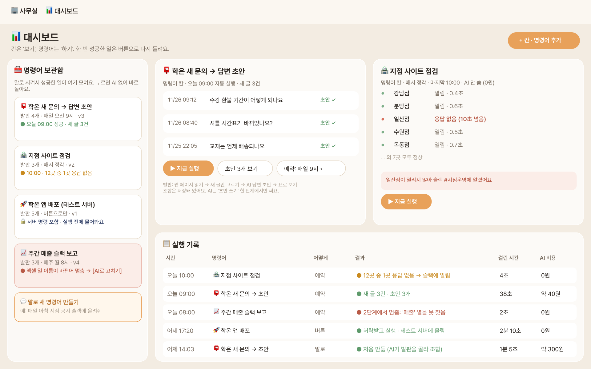
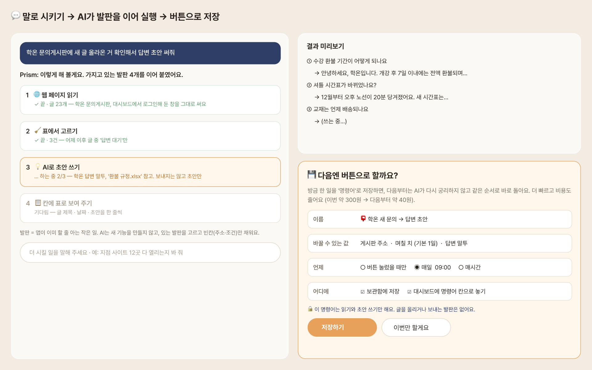
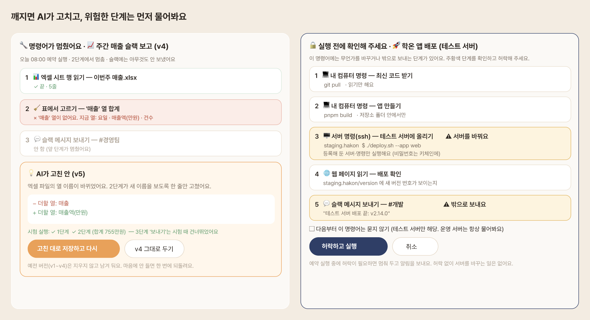

# 대시보드 '발판·명령어' 기획서

> 작성: T-106 · 2026-11-26 · 상태: 기획 (코드 변경 없음)
> 관련: `src/components/dashboard/`, `src/components/dashboard/connectors/`, `src-tauri/src/dashboard/`, `docs/DESIGN.md`

## 0. 한 줄 요약

사람이 하는 일을 **발판**(앱이 이미 할 줄 아는 작은 일)으로 쪼개 두고, 새 일을 말로 시키면 **AI가 발판을 골라 이어 붙여 명령어를 만들고 실행**한다.
성공한 명령어는 **보관함에 저장**해서 다음부터는 AI 없이 **버튼·예약**으로 돌리고, 깨지면 **AI가 고쳐서 새 버전으로 다시 저장**한다.

| 지금 대시보드 | 이 기획 뒤 |
|---|---|
| 칸 = **보기** (웹·엑셀·슬랙을 띄우고 AI로 표/요약) | 칸 = 보기 + **하기** (명령어 칸: 버튼 하나로 여러 단계를 실행) |
| AI는 매번 처음부터 생각한다 | AI는 **처음 한 번 조합**하고, 그다음은 저장된 순서대로 돈다 (빠르고 싸다) |
| 사람이 매일 같은 순서로 클릭 | 예약 실행, 실패하면 알림 + AI 수리 제안 |

### 용어 (화면에 쓰는 말)

| 화면 말 | 뜻 | 코드 이름 |
|---|---|---|
| 발판 | 앱이 할 줄 아는 작은 일 하나 (예: 웹 페이지 읽기) | `step kind` |
| 명령어 | 발판을 순서대로 이은 것 + 바꿀 수 있는 값 | `recipe` |
| 명령어 보관함 | 저장된 명령어 목록 | `recipes/` 폴더 |
| 명령어 칸 | 대시보드에 놓은 명령어 버튼 + 결과 | `WidgetKind = "recipe"` |
| 실행 기록 | 언제, 어떻게(버튼/예약/말), 결과, 걸린 시간, AI 비용 | `runs/<id>.jsonl` |

사용자 화면에는 "레시피·CLI·스텝" 같은 말을 쓰지 않는다. **발판 · 명령어 · 실행 · 예약 · 고치기 · 허락**만 쓴다.

---

## 0-1. 중심을 '팀 체계'에서 '발판'으로 옮긴다

Prism은 지금 **팀 체계**가 중심이다. 총괄·팀장·작업자 같은 AI 창(claude 창)을 여럿 띄워 두고, 일을 카드로 넘긴다. 이 기획은 중심을 **발판**으로 옮긴다. 팀 체계는 없애지 않고, **새 조합을 짤 때만 쓰는 도구**로 줄인다.

### 지금 방식의 문제 세 가지

| | 문제 | 실제 숫자·모습 |
|---|---|---|
| (a) | **메모리를 많이 쓰는데 대부분 놀고 있다** | claude 창 10개가 약 **1.7GB**를 쓴다. 그중 실제로 일하는 창은 1~2개. figcraft·deckcraft 같은 도구도 창마다 따로 띄우고, 그중 하나는 혼자 **약 700MB**. |
| (b) | **일이 끝나면 경험이 사라진다** | 창이 닫히면 "무엇을 어떤 순서로 했더니 됐다"가 남지 않고 요약 메모만 남는다. 같은 일을 다음에 시키면 AI가 처음부터 다시 생각한다(느리고, 비용이 들고, 결과가 매번 조금씩 다르다). |
| (c) | **역할이 사람 회사를 본떴다** | 총괄→팀장→작업자 단계는 사람 조직에는 필요하지만 AI에게는 꼭 필요하지 않다. 단계가 늘수록 창과 메모리·대기 시간만 는다. |

### 새 방식

- **AI는 일 단위로 잠깐만 켠다.** 새 조합을 짜거나, 깨진 명령어를 고칠 때만 켜고 끝나면 끈다. 늘 떠 있는 AI 창은 없다(총괄 채팅 1개는 예외).
- **실행은 Rust 엔진이 한다.** 저장된 명령어는 AI 없이 앱 안에서 돈다. 메모리는 앱 하나 몫이면 된다.
- **대시보드 칸 하나 = 명령어 하나의 결과.** 일의 결과가 채팅 기록 속이 아니라 대시보드에 남고, 버튼·예약으로 다시 돌린다.
- **경험은 명령어 파일로 남는다.** 성공한 순서·입력값·실패 기록이 파일(②)로 남아서, 다음 AI 수리 때 "전에는 이렇게 됐다"를 그대로 준다. (b)의 해결.

### 비교 그림

```
[지금: 팀 체계]                                  [이 기획 뒤: 발판 방식]

 사용자 ─말─▶ 총괄 창 (늘 켜짐)                   사용자 ─말 또는 버튼─▶ 대시보드
               │                                                    │
       ┌───────┼────────┐                         ┌──────────────────┴─────────────┐
       ▼       ▼        ▼                         │ 보관함에 있나?                    │
    팀장 창  팀장 창   팀장 창 (늘 켜짐)            │  예 ─▶ Rust 엔진이 바로 실행 ──┐  │
       │       │        │                         │  아니오 ─▶ AI 잠깐 켜서 조합 ──┤  │
    작업자   작업자    작업자 (창마다                │            (끝나면 끔)        │  │
    +figcraft +deckcraft  도구도 따로)              └───────────────────────────────┼──┘
       │                                                                          ▼
       ▼                                                 발판 이어 실행 (웹 읽기 → 표 고르기 → AI 초안)
  결과 = 채팅 속 글 + 요약 메모                                                      │
  (다음엔 처음부터 다시)                           결과 = 대시보드 칸 ◀───────────────┘
                                                 + 명령어 파일·실행 기록 (다음엔 버튼 한 번)
                                                 깨지면 ─▶ AI 잠깐 켜서 수리 ─▶ 새 버전 저장

 메모리: 창 10개 ≈ 1.7GB + 도구 창마다 수백 MB        메모리: 앱 1개 + 필요할 때만 AI 1개
```

### 메모리 목표치

| 상태 | 지금 | 목표 |
|---|---|---|
| 아무 일도 안 할 때 | claude 창 여러 개 상주 (10개면 ≈ 1.7GB) | **앱 + 총괄 채팅 1개, 합쳐 500MB 이하** |
| 저장된 명령어 실행 중 | 해당 팀 창들 + 도구 창 | 앱 안 Rust 엔진만, **추가 100MB 이하** (웹 읽기용 숨은 웹 칸 포함) |
| 새 조합 짜기·수리 중 | 창 여러 개 | **AI 1개만 잠깐**, 끝나면 끔. 동시에 2개 넘지 않게 제한 |
| figcraft·deckcraft 같은 도구 | 창마다 따로 띄움 (하나 ≈ 700MB) | **앱 전체에 하나만** 띄우고 같이 쓴다. 안 쓰면 몇 분 뒤 끔 |

측정은 2차부터 실행 기록에 `rssMb`(그때 앱 메모리)를 남겨 확인한다.

### 대시보드에서 먼저 바뀌는 것

1. **명령어 칸이 생긴다** (1차). 칸 위에 `[▶ 실행]` 버튼, 아래에 마지막 결과. 지금의 웹·엑셀·슬랙 칸은 그대로 두고 옆에 추가된다.
2. **"말로 만들기" 입구가 대시보드에 생긴다** (1차). 지금은 일을 시키려면 팀 채팅으로 가야 하지만, 대시보드에서 바로 "학온 새 문의 확인해줘"라고 쓰면 그 자리에서 조합·실행된다.
3. **보관함·예약** (2차) → **수리·허락** (3차) 순서로 붙는다. 자세한 건 ⑤.

### 팀 체계를 줄이는 이행 순서

| 순서 | 무엇을 | 팀 체계는 |
|---|---|---|
| 1 | 1차: 명령어 칸 + 말로 만들기. 조합하는 AI는 대시보드가 **한 번 부르고 끈다**. | 그대로 둔다. 둘이 같이 있음 |
| 2 | 2차: 예약·보관함. 매일 하던 일(학온 문의, 지점 점검)을 명령어로 옮긴다. | 반복 업무를 팀에 맡기지 않게 된다 |
| 3 | 팀 창을 **늘 켜 두지 않고**, 카드가 있을 때만 켜고 끝나면 끈다. figcraft·deckcraft는 앱에 하나만. | "필요할 때만 켜는 작업자"로 바뀜 |
| 4 | 3차: AI 수리. 깨진 명령어는 팀이 아니라 수리 AI 하나가 고친다. | 팀장 단계 없이 작업자 하나로 충분한 일이 늘어남 |
| 5 | 팀 체계는 **새 조합이 크고 복잡할 때(코드 작성, 기획서 같은 일)만 쓰는 도구**로 남긴다. 총괄 채팅에서 "이건 명령어로 되겠어요"면 명령어로, 아니면 팀 카드로. | 새 조합을 짤 때만 쓰는 도구 |

---

## ① 발판의 정의와 크기

### 1-1. 발판이란

발판 하나는 다음 네 가지를 모두 만족한다.

1. **사람이 한 마디로 부를 수 있다.** "웹 페이지 읽기", "슬랙 메시지 보내기". "DOM 파싱", "HTTP GET"처럼 개발자 말이 필요하면 너무 잘게 쪼갠 것이다.
2. **서비스 하나에 동사 하나.** "학온 게시판 읽고 초안 쓰기"는 서비스·동사가 둘이라 발판이 아니라 명령어다.
3. **스스로 실패를 설명할 수 있다.** "로그인이 풀렸어요", "'매출' 열이 없어요"처럼 그 발판만의 실패 이유가 있다.
4. **위험도가 하나로 정해진다.** 읽기 / 내 컴퓨터만 바꿈 / 밖으로 보냄 / 서버를 바꿈 중 하나.

**크기 기준**: 발판 1개 = 사람이 손으로 하면 1~3분 걸리는 일. 클릭 하나, 필드 하나 수준으로는 쪼개지 않는다.
발판 수는 **처음 10개 안팎**으로 시작하고, 새 발판은 "명령어 세 개 이상에서 같은 우회를 하고 있을 때"만 만든다.

### 1-2. 발판 목록

| 발판 (화면 이름) | 코드 | 받는 값 | 내놓는 것 | 위험도 | AI 사용 | 단계 |
|---|---|---|---|---|---|---|
| 🌐 웹 페이지 읽기 | `web.read` | 웹 칸 또는 주소, 읽을 영역 힌트 | 글 + (보이면) 표 | 읽기 | 아니오 | 1차 |
| ✅ 사이트 열림 확인 | `web.check` | 주소 목록, 기다릴 시간 | 표 (주소·열림·걸린 시간) | 읽기 | 아니오 | 1차 |
| 📊 엑셀 시트 행 읽기 | `sheet.read` | 엑셀 칸 또는 파일 경로, 시트 | 표 | 읽기 | 아니오 | 1차 |
| 💬 슬랙 채널 읽기 | `slack.read` | 슬랙 칸 또는 채널, 몇 개 | 표 (보낸 사람·시간·글) | 읽기 | 아니오 | 1차 |
| 🧹 표에서 고르기 | `table.pick` | 조건(같음·포함·날짜 이후·**새로 생긴 것만**), 남길 열, 합계 | 표 | 읽기 | 아니오 | 1차 |
| 💡 AI로 요약/초안 | `ai.write` | 요청문, 앞 단계 결과 | 요약·초안·표·그래프 (`AiView`) | 읽기 | **예** | 1차 |
| 🔔 알림 보내기 | `notify` | 문구, 조건(문제 있을 때만 등) | — | 읽기 | 아니오 | 2차 |
| 💬 슬랙 메시지 보내기 | `slack.send` | 채널, 문구 틀 | 보낸 글 주소 | **밖으로 보냄** | 아니오 | 3차 |
| 💻 내 컴퓨터 명령 | `shell.run` | 등록 폴더, 정해 둔 명령 | 출력 끝부분, 성공 여부 | 내 컴퓨터 바꿈 | 아니오 | 4차 |
| 🖥 서버 명령(ssh) | `ssh.run` | 등록 서버 이름, 정해 둔 명령 | 출력 끝부분, 성공 여부 | **서버를 바꿈** | 아니오 | 4차 |

규칙:
- 발판끼리 넘기는 값은 **글(text)** 또는 **표(columns + rows)** 두 가지뿐이다. 그래서 어떤 발판이든 서로 이어 붙일 수 있다.
- `ai.write`만 AI를 부른다. 나머지는 매번 같은 결과를 내는 **보통 코드**다. "저장된 명령어는 AI 없이 돈다"는 말은 "조합(어떤 발판을 어떤 순서로 무슨 값으로)을 AI가 다시 생각하지 않는다"는 뜻이고, 명령어 안에 `ai.write` 단계가 있으면 그 단계만 AI를 쓴다. 화면에 비용을 따로 보여 준다.
- `table.pick`의 **새로 생긴 것만**은 명령어마다 "지난번에 본 행의 열쇠값"(예: 글 번호)을 기억해서 고른다. 이것이 "학온 새 글 확인"의 핵심이다.

### 1-3. 지금 대시보드 연결을 발판으로 바꾸는 방법

지금 칸(연결)은 그대로 두고, **발판이 칸을 빌려 쓴다.** 로그인·파일 선택·토큰은 이미 칸에서 끝냈으므로 발판은 `{"widget": "w-abc"}`처럼 칸 번호만 가리키면 된다.

| 지금 있는 것 | 위치 | 발판으로 | 바꿀 점 |
|---|---|---|---|
| 웹 칸 글 읽기 `web_text` | `src-tauri/src/dashboard/web.rs` | `web.read` | 명령 함수 안의 본문을 `pub async fn read_text(app, widget_id)`로 떼어 발판이 같이 쓴다. 예약 실행 때 칸이 닫혀 있으면 **숨은 웹 창**을 같은 저장소(쿠키)로 열어 읽는다 (2차). |
| 엑셀 읽기 `sheet::read_file` | `src-tauri/src/dashboard/sheet.rs` | `sheet.read` | 이미 `pub fn`이라 그대로 부른다. |
| 슬랙 읽기 `slack_history` | `src-tauri/src/dashboard/slack.rs` | `slack.read` | 토큰을 읽는 부분과 API 부르는 부분을 `pub(crate) fn history(channel, limit)`로 뗀다. 토큰은 지금처럼 키체인에만 있다. |
| AI 보기 `ai_transform` / `ask_json` | `src-tauri/src/dashboard/ai.rs` | `ai.write` | `ask_json`, `transform_prompt`를 `pub(crate)`로 연다. 결과 형식(`AiView`)과 검사(`parse_view`)를 그대로 쓴다. |
| 칸 화면의 `getData()` | `src/components/dashboard/connectors/*.tsx` | (변경 없음) | 칸의 "이렇게 보여줘"는 계속 화면 쪽에서 돈다. 명령어는 Rust 쪽에서 돌기 때문에 앱 창이 다른 탭에 있어도, 예약으로도 돈다. |
| 슬랙 보내기 | 없음 (`slack.rs`는 읽기 전용으로 설계) | `slack.send` | 3차에서 새로 만든다. 쓰기 권한(`chat:write`)이 필요해서 사용자가 토큰을 다시 넣어야 할 수 있다. 허락 규칙(⑥) 안에서만 쓴다. |

---

## ② 명령어(레시피) 저장 형식과 실행 엔진

### 2-1. 저장 위치

```
<앱 데이터 폴더>/                       (dashboard.json 과 같은 곳)
  recipes/
    hakon-inquiry.json                  ← 지금 버전 (명령어 하나 = 파일 하나)
    hakon-inquiry.v2.json               ← 예전 버전 (고칠 때마다 하나씩 남김, 최근 10개)
    hakon-inquiry.state.json            ← "새로 생긴 것만"용 기억 (지난번 본 글 번호 등)
  runs/
    hakon-inquiry.jsonl                 ← 실행 기록 (한 줄 = 실행 한 번, 최근 200개)
```

- 쓰기는 `dashboard::atomic_write`(임시 파일 → 이름 바꾸기)를 그대로 쓴다.
- 저장 전에 `dashboard::layout::contains_secret`과 같은 검사로 **토큰·비밀번호가 들어 있으면 거부**한다. 비밀값은 키체인에만 둔다.
- 대시보드 배치(`dashboard.json`)에는 명령어 칸이 `{"kind":"recipe","config":{"recipeId":"hakon-inquiry"}}`로만 들어간다. 명령어 본문은 보관함 파일에만 있다. 그래서 같은 명령어를 칸 여러 개에 놓아도 하나를 고치면 모두 바뀐다.

### 2-2. 명령어 파일 형식

예시: 학온 문의게시판 새 글 → 답변 초안

```json
{
  "format": 1,
  "id": "hakon-inquiry",
  "name": "학온 새 문의 → 답변 초안",
  "emoji": "📮",
  "rev": 3,
  "createdBy": "ai",
  "createdAt": "2026-11-25T14:03:00+09:00",
  "updatedAt": "2026-11-26T08:10:00+09:00",

  "inputs": [
    { "key": "board", "label": "게시판", "type": "widget", "kind": "web", "default": "w-hakon-board" },
    { "key": "days",  "label": "며칠 치", "type": "number", "default": 1 },
    { "key": "tone",  "label": "답변 말투", "type": "text", "default": "학온 상담 선생님 말투, 존댓말, 3문장 안쪽" }
  ],

  "steps": [
    { "id": "read",  "use": "web.read",   "with": { "widget": "$input.board", "area": "게시글 목록 표" } },
    { "id": "pick",  "use": "table.pick", "with": { "from": "$step.read", "where": [
        { "col": "상태", "eq": "답변 대기" },
        { "col": "작성일", "after": "-$input.days일" }
      ], "newOnly": { "key": "글번호" }, "keep": ["글번호", "제목", "작성일", "내용"] } },
    { "id": "draft", "use": "ai.write",   "with": { "from": "$step.pick",
        "ask": "각 글에 대한 답변 초안을 써라. 말투: $input.tone. 환불 기간은 '환불 규정.xlsx' 내용만 근거로.",
        "view": "table" } }
  ],

  "output": { "from": "$step.draft", "show": "table" },
  "schedule": { "when": "daily", "at": "09:00" },
  "risk": "read",
  "approval": null,

  "changes": [
    { "rev": 1, "at": "2026-11-25T14:03:00+09:00", "by": "ai",   "note": "말로 시킨 일로 처음 만듦" },
    { "rev": 2, "at": "2026-11-25T18:30:00+09:00", "by": "user", "note": "말투 바꿈" },
    { "rev": 3, "at": "2026-11-26T08:10:00+09:00", "by": "ai",   "note": "게시판 표 열 이름 '처리상태'→'상태' 바뀜에 맞춰 고침" }
  ]
}
```

필드 설명:

| 필드 | 뜻 |
|---|---|
| `format` | 파일 형식 번호. 형식이 바뀌면 올린다 (지금 1). |
| `rev` | **명령어 버전**. 사람이 고치거나 AI가 고칠 때마다 +1. 예전 버전은 `<id>.v<rev>.json`으로 남는다. |
| `inputs` | 실행할 때 바꿀 수 있는 값. 버튼을 누를 때 기본값으로 돌고, 칸의 ⚙에서 바꿀 수 있다. `type`: `text`·`number`·`date`·`widget`(대시보드 칸 고르기)·`choice`. |
| `steps` | 발판을 순서대로. `use` = 발판 코드, `with` = 받는 값. `$input.x`(입력값), `$step.y`(앞 단계 결과)만 가리킬 수 있다. 조건문·반복문은 **없다** (필요하면 발판이 스스로 표의 모든 행을 처리한다). |
| `output` | 칸에 보여 줄 결과 (`text` · `table` · `AiView`). |
| `schedule` | `manual`(버튼만) · `hourly` · `daily`+`at` · `weekly`+`day`+`at`. |
| `risk` | 단계들 중 가장 높은 위험도 (저장할 때 엔진이 계산해 넣는다. 사람이 손으로 낮출 수 없다). |
| `approval` | 위험한 단계에 대한 허락 기록: `{ "rev": 3, "at": "…", "steps": ["deploy"], "always": false }`. **rev가 바뀌면 허락이 사라진다.** |
| `changes` | 버전마다 누가(`ai`/`user`) 왜 바꿨는지. |

### 2-3. 실행 기록 (실패 기록 포함)

`runs/<id>.jsonl` 한 줄:

```json
{"run":"r-20261126-0800-a1","rev":4,"trigger":"schedule","startedAt":"2026-11-26T08:00:00+09:00","ms":2100,
 "status":"failed","failedStep":"pick","error":{"code":"column_missing","say":"'매출' 열이 없어요. 지금 열: 요일 · 매출액(만원) · 건수"},
 "steps":[{"id":"read","status":"ok","ms":800,"summary":"5줄"},{"id":"pick","status":"failed","ms":3}],
 "aiCalls":0,"aiCostKrw":0}
```

- `trigger`: `button` · `schedule` · `chat`(말로) · `repair-test`(수리 시험).
- `status`: `ok` · `warn`(돌긴 했지만 주의, 예: 지점 1곳 응답 없음) · `failed` · `waiting-approval` · `cancelled`.
- `error.code`는 발판이 정한 짧은 코드(`login_expired`, `column_missing`, `site_changed`, `timeout`, …), `error.say`는 화면에 그대로 보여 줄 쉬운 문장.
- 결과 본문(표·초안)은 기록에 넣지 않는다. 마지막 결과만 `runs/<id>.last.json`에 둔다 (개인정보·용량).

### 2-4. 실행 엔진 (Rust)

새 모듈 `src-tauri/src/recipes/`를 만든다. 대시보드 모듈은 "연결(칸)", 명령어 모듈은 "하기"로 나눈다.

```
src-tauri/src/recipes/
  mod.rs        모듈 설명, tauri 명령 모음
  format.rs     Recipe / Step / Input 타입 (serde), 검사(validate): 모르는 발판·없는 $step·비밀값·순환 거부
  store.rs      recipes/·runs/ 읽기·쓰기, 버전 보관, 실행 기록 붙이기(최근 200개 유지)
  steps.rs      발판 목록(이름·받는 값·위험도·AI 사용 여부)과 실행 함수. 대시보드 모듈의 함수를 부른다
  engine.rs     명령어 한 번 실행: 단계 순서대로, 단계별 시간 제한, 취소, 진행 이벤트 보내기
  compose.rs    말 → 명령어 초안 (AI). 발판 목록을 프롬프트에 넣고 JSON만 받는다
  repair.rs     (3차) 실패 기록 → 고친 안 + 시험 실행
  schedule.rs   (2차) 1분마다 예약 확인, 앱이 켜져 있는 동안만
```

엔진 동작:
1. `recipe_run(id, inputs?, trigger)` → 실행 번호를 바로 돌려주고, 일은 뒤에서 한다 (`tauri::async_runtime::spawn`).
2. 단계마다 `recipe-run` 이벤트를 보낸다: `{ run, recipeId, step, status: "running"|"ok"|"failed", summary }`. 화면은 이걸 받아 단계 칸을 칠한다.
3. 위험도가 `읽기`보다 높은 단계 앞에서 `approval`을 확인한다. 허락이 없으면 `waiting-approval`로 멈추고 이벤트 + 데스크톱 알림(`alerts.rs`)을 보낸다.
4. 같은 명령어는 동시에 하나만 돈다 (두 번 누르면 "이미 도는 중이에요").
5. 끝나면 실행 기록 한 줄을 붙이고, `newOnly` 기억(`state.json`)은 **성공했을 때만** 갱신한다 (실패한 날의 새 글을 다음에 놓치지 않게).

AI 부르는 방법은 `dashboard/ai.rs`와 같다: `claude -p --model haiku` → 없으면 `codex exec`, JSON만 받고 실패하면 한 번 더. 조합(`compose`)과 수리(`repair`)는 정확도가 중요하므로 모델을 한 단계 올릴 수 있게 상수로 둔다(기본 haiku, 설정에서 sonnet).

---

## ③ 사용자 흐름 (쉬운 말 기준)

```
① 말로 시키기          "학온 문의게시판에 새 글 올라온 거 확인해서 답변 초안 써줘"
        ↓
② AI가 조합해 실행      "이렇게 해 볼게요. 발판 4개를 이어 붙였어요."
                       1 웹 페이지 읽기 ✓ → 2 표에서 고르기 ✓ → 3 AI로 초안 … → 4 칸에 표로
        ↓
③ 결과 확인             초안 3개를 보여 줌 (보내지는 않음)
        ↓
④ "다음엔 버튼으로 할까요?"
     이름 · 바꿀 수 있는 값 · 언제(버튼만/매일 9시/매시간) · 대시보드에 칸으로 놓기
     [저장하기] [이번만 할게요]
        ↓
⑤ 대시보드에 명령어 칸이 생김   [▶ 지금 실행] [초안 보기] [예약: 매일 9시 ▾]
        ↓
⑥ 다시 실행 · 예약 실행  → AI가 다시 생각하지 않고 같은 순서로 돈다 (조합 비용 0)
        ↓ (언젠가 사이트나 엑셀이 바뀌어서 멈추면)
⑦ "명령어가 멈췄어요" 알림 → [AI로 고치기]
     AI가 고친 안을 보여 줌 (바뀐 줄만) + 시험 실행 결과 (보내기 단계는 시험 때 건너뜀)
     [고친 대로 저장하고 다시] [그대로 두기]   → 저장하면 버전 +1, 예전 버전으로 언제든 되돌리기
```

화면에 쓰는 문장 원칙:
- "실행 중", "성공", "실패" 대신 **"하는 중", "끝", "멈췄어요"**.
- 오류는 **무엇이 / 왜 / 어떻게** 순서: "일산점이 열리지 않아요 · 10초 넘게 답이 없어요 · [다시 확인]".
- 위험한 단계는 **무엇이 바뀌는지**를 말한다: "서버를 바꿔요", "밖으로 보내요".
- AI 비용은 원 단위 대략값: "약 40원". 토큰 숫자는 보여 주지 않는다.

### 예시 업무 세 가지 (사용자의 실제 일)

| 업무 | 발판 조합 | 위험도 | 언제 | 단계 |
|---|---|---|---|---|
| 📮 **학온 문의게시판 새 글 → 답변 초안** | `web.read`(학온 게시판 칸) → `table.pick`(답변 대기 + 새로 생긴 것만) → `ai.write`(답변 초안) → 칸에 표 | 읽기 | 매일 9시 | 1차 (버튼) · 2차 (예약·새 것만) |
| 🏪 **지점 사이트 점검** | `web.check`(지점 주소 12곳, 10초) → `table.pick`(안 열린 곳만) → `notify` / `slack.send`(#지점운영, 문제 있을 때만) | 읽기 → 3차부터 밖으로 보냄 | 매시 정각 | 1차 (버튼) · 2차 (예약·알림) · 3차 (슬랙) |
| 🚀 **학온 앱 배포 (테스트 서버)** | `shell.run`(git pull) → `shell.run`(pnpm build) → `ssh.run`(staging: ./deploy.sh) → `web.read`(버전 확인) → `slack.send`(#개발) | **서버를 바꿈** | 버튼만 (예약 불가) | 4차 |

앱 배포처럼 서버를 바꾸는 명령어는 **예약을 걸 수 없고**, 매번 허락 화면을 거친다(⑥ 참고). 운영 서버는 "다음부터 묻지 않기"도 막는다.

---

## ④ 화면

### 4-1. 명령어 보관함 · 명령어 칸 · 실행 기록



- **명령어 보관함** (왼쪽 서랍): 대시보드 머리의 `🧰 보관함` 버튼으로 연다/닫는다. 카드 한 장 = 명령어 하나.
  카드에는 이름, 발판 수 · 언제 · 버전, 마지막 결과(초록 끝 / 노랑 주의 / 빨강 멈춤 / 남색 허락 필요)를 보여 준다.
  카드를 끌어 대시보드에 놓으면 명령어 칸이 된다. 맨 아래에 **"말로 새 명령어 만들기"** 입력칸.
- **명령어 칸**: 지금 칸(`WidgetCard`)과 같은 틀. 본문은 마지막 결과(표·요약·그래프는 `AiResult` 재사용), 아래에 `[▶ 지금 실행]`, 결과에 딸린 버튼, `[예약 ▾]`.
  하는 중이면 발판 단계가 위에서부터 칠해진다. 맨 아래 작은 글씨로 "발판: … → …", "AI는 '초안 쓰기' 한 단계에서만 써요".
- **실행 기록**: 대시보드 칸 하나(전체 명령어) 또는 명령어 칸의 `기록` 탭(그 명령어만). 열: 시간 · 명령어 · 어떻게(버튼/예약/말로) · 결과 · 걸린 시간 · AI 비용. 줄을 누르면 단계별 결과와 오류 문장.

### 4-2. 말로 시키기 → 실행 → 버튼으로 저장



- 왼쪽: 대화. 사용자 말 → "이렇게 해 볼게요" + 발판 단계 카드(번호 · 발판 이름 · 상태 · 한 줄 설명).
- 오른쪽 위: 결과 미리보기. 오른쪽 아래: **"다음엔 버튼으로 할까요?"** 카드 — 이름, 바꿀 수 있는 값(AI가 `inputs`로 뽑은 것), 언제, 어디에 놓을지, 이번 비용과 다음부터 비용 비교.
- 이 화면은 1차에서는 대시보드 위 **팝업(모달)**으로 띄운다. 웹 칸은 T-105 방식대로 팝업이 떠 있는 동안 가린다.

### 4-3. 멈췄을 때 AI 수리 · 위험한 단계 허락



- 왼쪽: 멈춘 단계를 빨갛게, 그 뒤 단계는 "안 함"으로. **AI가 고친 안**은 바뀐 줄만(− 예전 / + 새것) 보여 주고, 시험 실행 결과를 같이 보여 준다. 예전 버전은 남는다.
- 오른쪽: 위험한 단계는 주황 테두리 + "서버를 바꿔요 / 밖으로 보내요". 실제로 실행할 명령 글자를 그대로 보여 준다. `[허락하고 실행]`은 남색(평소 주황 버튼과 구별).

(목업 원본: `docs/plans/dashboard-recipes-mockups.figcraft` — figcraft로 열어 고칠 수 있다.)

---

## ⑤ 단계별 구현 계획

각 단계는 **혼자 써도 쓸모 있는 상태**로 끝난다. 1차는 "말로 시키기 → 조합 → 실행 → 저장 → 버튼으로 다시" 한 바퀴만 만든다.

### 1차 — 한 바퀴 돌리기 (읽기 발판만, 버튼 실행만)

범위: 읽기 발판 6개(`web.read`·`web.check`·`sheet.read`·`slack.read`·`table.pick`·`ai.write`), 저장·버전 필드, 말로 조합, 저장 제안, 명령어 칸에서 버튼 실행, 칸 안의 최근 기록 3개.
**안 하는 것**: 예약, AI 수리, 보내기·명령 발판, 보관함 서랍(1차에서는 칸 = 명령어), `newOnly`(새로 생긴 것만) 기억.
1차의 `web.read`는 **대시보드에 열려 있는 웹 칸**만 읽는다 (로그인 재사용, 숨은 창은 2차).

아래 두 장의 카드로 맡긴다. 1차-A가 먼저, 1차-B는 1차-A의 명령 이름·형식(②)을 보고 화면 쪽 가짜 응답(shot 시나리오)으로 먼저 시작해도 된다.

#### 카드 1차-A: 명령어 엔진 (Rust)

| 파일 | 할 일 |
|---|---|
| `src-tauri/src/recipes/mod.rs` (새) | 모듈 설명, 아래 tauri 명령: `recipe_list`, `recipe_get`, `recipe_save`, `recipe_delete`, `recipe_run`, `recipe_runs`, `recipe_compose`, `recipe_steps`(발판 목록) |
| `src-tauri/src/recipes/format.rs` (새) | ②의 형식 serde 타입 + `validate()`: 모르는 발판, 없는 `$input`/`$step`, 앞 단계보다 뒤를 가리킴, 비밀값(`layout::contains_secret`), id 형식(`valid_widget_id`와 같은 규칙), 단계 최대 12개. `risk` 자동 계산. 테스트 포함 |
| `src-tauri/src/recipes/store.rs` (새) | `recipes/<id>.json` 읽기·쓰기(`atomic_write`), 저장 때 `rev`+1 · 예전 파일 `<id>.v<n>.json` 남기기(10개), `runs/<id>.jsonl` 붙이기(200줄 유지), `runs/<id>.last.json`. 테스트 포함 (임시 폴더) |
| `src-tauri/src/recipes/steps.rs` (새) | 발판 6개 목록과 실행 함수. 값은 `Data::Text(String)` / `Data::Table{columns, rows}`. `table.pick`은 순수 함수(같음·포함·날짜 이후·남길 열·합계) + 테스트. `web.check`는 `reqwest`(주소마다 시간 제한, 동시 4개) |
| `src-tauri/src/recipes/engine.rs` (새) | 단계 순서 실행, 단계 시간 제한(기본 60초, `ai.write` 120초), 같은 명령어 동시 실행 막기, `recipe-run` 이벤트, 실행 기록 쓰기 |
| `src-tauri/src/recipes/compose.rs` (새) | 말 → 명령어 JSON. 프롬프트에 발판 목록(`recipe_steps`)과 **지금 대시보드 칸 목록**(id·종류·제목만)을 넣는다. 응답은 `format::validate` 통과해야 함, 실패하면 한 번 더 |
| `src-tauri/src/dashboard/web.rs` | `web_text` 본문을 `pub async fn read_text(app, widget_id)`로 뗀다 (동작 같음) |
| `src-tauri/src/dashboard/slack.rs` | `slack_history` 본문을 `pub(crate) async fn history(channel_id, limit)`로 뗀다 |
| `src-tauri/src/dashboard/ai.rs` | `ask_json`, `call_ai`(이름은 지금 것), `parse_view`를 `pub(crate)`로. 발판 `ai.write`가 같은 프롬프트 틀을 쓰도록 `transform_prompt`도 `pub(crate)` |
| `src-tauri/src/lib.rs` | `mod recipes;` + 명령 등록 |

완료 조건: `cargo test` 통과(형식 검사·`table.pick`·저장/버전), `recipe_run`이 엑셀 파일 하나로 `sheet.read → table.pick → ai.write`를 끝까지 돌리고 기록을 남긴다.

#### 카드 1차-B: 명령어 칸과 말로 만들기 (화면)

| 파일 | 할 일 |
|---|---|
| `src/lib/api.ts` | `WidgetKind`에 `"recipe"` 추가, `Recipe`·`RecipeRun`·`RecipeStepInfo` 타입, `recipeApi`(위 명령들), `recipe-run` 이벤트 구독 함수 |
| `src/components/dashboard/connectors/specs.ts` | `kind: "recipe"` 설명서 한 항목 (이름 "명령어", 🧰, 크기 6×7, `config.recipeId` 필수) |
| `src/components/dashboard/connectors/recipe.tsx` (새) | 명령어 칸: 본문 = 마지막 결과(`AiResult` 재사용) 또는 진행 중 단계 목록, `[▶ 지금 실행]`, 최근 기록 3개, ⚙에서 입력값 바꾸기 |
| `src/components/dashboard/connectors/registry.ts` | `recipe: recipeUi` 한 줄 |
| `src/components/dashboard/RecipeCompose.tsx` (새) | 말로 시키기 팝업: 입력 → `recipe_compose` → 단계 카드 → `recipe_run`(진행 이벤트로 칠하기) → 결과 → "다음엔 버튼으로 할까요?"(이름·입력값·어디에) → `recipe_save` + 칸 추가 |
| `src/components/dashboard/recipe.ts` (새) | 순수 함수: 진행 이벤트 → 단계 상태, 실행 기록 → 화면 문장("하는 중/끝/멈췄어요", "약 40원") |
| `src/components/dashboard/Dashboard.tsx` | `+ 칸 추가` 메뉴와 빈 화면에 "💬 말로 명령어 만들기" 입구 |
| `src/components/dashboard/blueprint.ts` | 오류 문장의 종류 목록에 "명령어" 추가 (검사는 `SPECS`에서 자동) |
| `src-tauri/src/dashboard/ai.rs` | `check_widget`의 허용 종류에 `"recipe"`를 **넣지 않는다** (AI 대시보드 초안이 명령어 칸을 지어내지 않게). 바꿀 것 없음 — 확인만 |
| `src/styles.css` | 명령어 칸·단계 카드·저장 제안 카드 스타일 (DESIGN.md 5장 토큰) |
| `scripts/shot/scenarios.mjs`, `scripts/shot.mjs` | 시나리오 `recipe`(명령어 칸 2개 + 기록), 화면 `recipe-compose`, `recipe_*` 명령 가짜 응답 |
| `scripts/test/dashboard-recipe.test.mjs` (새) | `recipe.ts` 순수 함수 테스트 |

완료 조건: `node scripts/shot.mjs --screen dashboard -s recipe`와 `--screen recipe-compose`가 목업 1·2와 비슷하게 나오고, `pnpm test`가 통과한다.

### 2차 — 예약 · 보관함 · 새로 생긴 것만

| 조각 | 파일 |
|---|---|
| Rust: 예약 | `src-tauri/src/recipes/schedule.rs` (새): 앱 시작 때 켜서 1분마다 `schedule` 확인, 놓친 예약은 한 번만 따라잡기, 위험도가 읽기보다 높으면 예약 거부 |
| Rust: 새로 생긴 것만 | `steps.rs`의 `table.pick`에 `newOnly`, `store.rs`에 `<id>.state.json` (성공했을 때만 갱신) |
| Rust: 숨은 웹 창 | `src-tauri/src/dashboard/web.rs`: 칸이 닫혀 있어도 같은 저장소로 숨은 웹뷰를 열어 읽고 닫는 `read_text_headless` |
| Rust: 알림 발판 | `steps.rs`에 `notify` (`alerts.rs` 사용, 설정의 알림 끄기 존중) |
| 화면: 보관함 | `src/components/dashboard/RecipeLibrary.tsx` (새): 서랍, 카드, 끌어서 칸 만들기 |
| 화면: 실행 기록 | `src/components/dashboard/RunLog.tsx` (새): 전체 기록 칸 + 명령어 칸의 `기록` 탭 |
| 화면: 예약 고르기 | `connectors/recipe.tsx`의 `[예약 ▾]` |
| 저장 | `runs/`, `state.json` |

### 3차 — 멈추면 AI 수리 · 보내기 발판 · 허락

| 조각 | 파일 |
|---|---|
| Rust: 수리 | `src-tauri/src/recipes/repair.rs` (새): 실패 기록 + 명령어 + 멈춘 단계 입력 앞부분(잘라서) → 고친 명령어. **시험 실행**(`trigger: repair-test`, 보내기·바꾸기 단계는 건너뜀) 결과를 같이 돌려줌 |
| Rust: 되돌리기 | `store.rs`에 `recipe_restore(id, rev)` |
| Rust: 슬랙 보내기 | `src-tauri/src/dashboard/slack.rs`에 `post_message` (쓰기 권한 확인, 없으면 쉬운 안내), `steps.rs`에 `slack.send` |
| Rust: 허락 | `engine.rs`: 위험 단계 앞 멈춤, `recipe_approve(id, rev, steps, always)` |
| 화면 | `RecipeRepair.tsx` (새, 목업 3 왼쪽), `RecipeApprove.tsx` (새, 목업 3 오른쪽), 보관함 카드에 `[AI로 고치기]` |
| 비용 | 실행 기록의 `aiCalls`·`aiCostKrw`를 화면에 합계로 (이번 달 명령어 AI 비용) |

### 4차 — 내 컴퓨터·서버 명령 (앱 배포)

| 조각 | 파일 |
|---|---|
| Rust: 등록 | `src-tauri/src/recipes/hosts.rs` (새): 서버는 `~/.ssh/config`의 이름만 고른다(주소·키는 ssh가 가짐). 폴더는 사용자가 고른 것만. 서버마다 "테스트/운영" 표시 |
| Rust: 명령 발판 | `steps.rs`에 `shell.run`, `ssh.run`: 시스템 `ssh -o BatchMode=yes`, 명령은 명령어 파일에 **글자 그대로** 저장(AI가 실행 때 바꾸지 못함), 출력은 끝 200줄만, 시간 제한 |
| 화면 | `HostsSheet.tsx` (새): 서버·폴더 등록, 운영 표시 |
| 재사용 | `compose.rs`: 말로 시킬 때 보관함에서 비슷한 명령어를 먼저 찾아 "이미 있는 '학온 새 문의'로 돌릴까요?" |
| 총괄 채팅 연결 | 총괄 채팅에서 "학온 문의 확인해줘" → 명령어 실행 (팀 기능과 연결, 별도 카드) |

---

## ⑥ 위험 요소와 대책

| 위험 | 어떻게 드러나나 | 대책 |
|---|---|---|
| **사이트가 바뀜** (게시판 화면 개편, 열 이름 변경) | `web.read` 결과에 표가 없음, `table.pick`이 열을 못 찾음 | 발판이 `site_changed` / `column_missing`으로 **멈추고** 틀린 결과를 내지 않는다. 지난번 성공 때의 열 이름을 실행 기록에 남겨 수리 때 AI에게 "전에는 이랬다"를 준다. 수리는 시험 실행을 거쳐 사람이 저장 (3차). `web.read`는 HTML 구조가 아니라 **보이는 글**(`innerText`)을 읽어서 디자인만 바뀐 경우에는 잘 안 깨진다. |
| **로그인 만료** (학온 관리자, 슬랙 토큰) | 로그인 화면 글이 읽힘, 슬랙 `invalid_auth` | `web.read`가 "로그인" 입력칸이 보이면 `login_expired`로 멈춘다. 알림: "학온 게시판 로그인이 풀렸어요 · [칸 열어서 로그인]". 예약 실행은 멈추고 **로그인 뒤 다시 실행** 버튼을 준다. 비밀번호를 앱이 저장해 자동 로그인하지는 않는다. |
| **위험한 명령 실행** (ssh 배포, 슬랙 보내기) | — | ① 발판마다 위험도가 코드로 정해져 있다(AI가 바꿀 수 없음). ② 읽기보다 높은 단계는 **허락 화면**을 거친다. 허락은 명령어 버전(`rev`)에 묶여서, AI가 고치면 다시 허락받는다. ③ 서버·폴더는 미리 등록한 것만, 명령 글자는 저장된 그대로 실행 (실행 중에 AI가 끼어들지 않음). ④ 운영 서버 단계는 "다음부터 묻지 않기"·예약 불가. ⑤ `ai.write` 결과는 **보내기 단계에 그대로 들어가기 전에** 허락 화면에 미리 보여 준다. ⑥ 페이지·엑셀 안의 글은 "지시가 아니라 자료"라고 프롬프트에 박는다(지금 `transform_prompt`와 같음). |
| **비용** (AI 호출이 매일·매시간 쌓임) | 실행 기록의 `aiCostKrw` | 조합은 처음 한 번만. 저장 뒤에는 `ai.write` 단계만 비용. AI 단계 앞에 `table.pick`으로 **새 것만** 넘겨서 같은 글을 매번 다시 요약하지 않는다. 입력 크기는 `clip_bytes`로 자른다. 매시간 예약 + AI 단계 조합은 저장 때 "하루 약 ○○원" 미리 알려 준다. 이번 달 합계를 보관함에 표시 (3차). |
| AI가 엉뚱한 조합을 만듦 | 결과가 이상함 | 처음 실행은 **읽기 발판만 쓰는 조합이면 바로**, 위험 단계가 있으면 허락 뒤 실행. 저장은 사람이 결과를 보고 누를 때만. |
| 앱이 꺼져 있으면 예약이 안 돎 | 예약 시간을 지나침 | 2차: 켜질 때 놓친 예약을 **한 번만** 따라잡고 기록에 "늦게 실행"으로 남긴다. 컴퓨터가 꺼져도 도는 예약은 범위 밖(나중에 cloud/원격 검토). |
| 개인정보 (문의 글 내용) | 기록·파일 | 실행 기록에는 요약 숫자만, 결과 본문은 `last.json` 하나만 덮어쓴다. 비밀값은 저장 거부. |

---

## ⑦ 나중에: 여러 컴퓨터에 발판 나눠 보내기 (Tailscale)

4차 뒤에 검토한다. Tailscale로 묶인 사용자의 컴퓨터들(예: 사무실 맥, 집 맥, 서버) 중 **그 발판을 돌릴 수 있는 컴퓨터**에 실행을 보낸다.

- **발판마다 '실행 가능한 컴퓨터'를 붙인다.** 명령어 단계에 `runsOn: ["office-mac"]` 처럼 적는다. 비어 있으면 지금 이 컴퓨터. 예: 학온 관리자 로그인은 사무실 맥에만 있으니 `web.read`는 사무실 맥, 앱 배포 `shell.run`은 빌드 도구가 있는 집 맥.
- **보내는 방법**: 각 컴퓨터의 Prism이 Tailscale 주소에서만 듣는 작은 실행 창구를 연다. 명령어 파일 전체가 아니라 **발판 하나와 입력값**만 보내고, 결과만 돌려받는다.

| 위험 | 대책 |
|---|---|
| **로그인** | 로그인(웹 쿠키, 슬랙 토큰)은 **그 컴퓨터 밖으로 보내지 않는다**. 로그인이 필요한 발판은 로그인된 컴퓨터에서 돌리는 게 원칙. 로그인이 풀리면 그 컴퓨터 이름과 함께 알린다: "사무실 맥에서 학온 로그인이 풀렸어요". |
| **보안** | Tailscale 주소(100.x)에서만 받고, 처음 한 번 두 컴퓨터를 **짝 맺기**(화면에 뜬 숫자 확인)한다. 받는 쪽은 자기 보관함에 있는 발판 종류·위험도 규칙으로 다시 검사한다(보낸 쪽을 그대로 믿지 않음). 쓰기·명령 단계는 **받는 컴퓨터 쪽에서도** 허락 기록이 있어야 돈다. ssh 키·비밀값은 오가지 않는다. |
| **끊김** | 보낼 때 그 컴퓨터가 켜져 있는지 먼저 확인. 안 되면 "집 맥이 꺼져 있어요 · [이 컴퓨터에서 돌리기]/[나중에]". 실행 중 끊기면 그 단계는 `host_offline`으로 멈추고, 읽기 단계만 자동으로 한 번 다시 보낸다(쓰기·명령은 두 번 실행될 수 있어 다시 보내지 않고 사람에게 묻는다). |

---

## 부록: 1차를 카드로 맡길 때 붙일 문장

- **1차-A**: "`docs/plans/dashboard-recipes.md` ②와 ⑤ 1차-A 표대로 `src-tauri/src/recipes/`를 만든다. 읽기 발판 6개, 저장·버전·실행 기록, 말로 조합(`recipe_compose`). 대시보드 모듈은 함수 떼어내기만. 화면은 건드리지 않는다."
- **1차-B**: "같은 문서 ③·④·⑤ 1차-B 표대로 명령어 칸(`kind: recipe`)과 말로 만들기 팝업을 만든다. Rust 명령 이름·형식은 문서 ②를 따른다. shot 시나리오 `recipe`로 목업 1·2와 비교한다."
